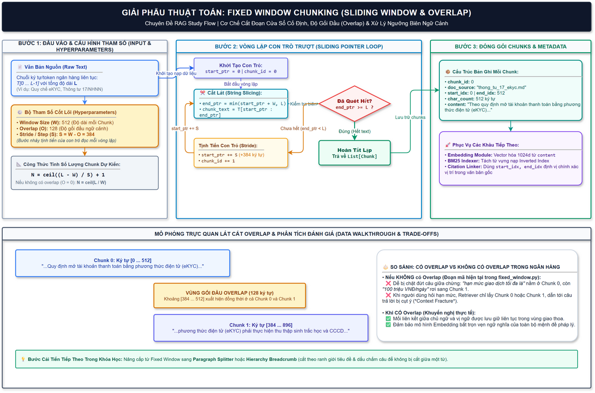

# 📚 CHUYÊN ĐỀ STUDY FLOW: THUẬT TOÁN FIXED WINDOW CHUNKING

> **Mục tiêu học tập**: Hiểu bản chất cơ chế cắt đoạn cửa sổ trượt (Sliding Window), vai trò của độ gối đầu (Overlap), công thức toán học và sự khác biệt thực tế khi áp dụng vào văn bản nghiệp vụ ngân hàng.

---

## 1. Sơ Đồ Thuật Toán Trực Quan (Draw.io Flowchart)



*(File thiết kế gốc: [`fixed_window_chunking.drawio`](fixed_window_chunking.drawio))*

---

## 2. Bản Chất Toán Học & Tham Số Cốt Lõi

Khi xử lý một văn bản ngân hàng $T$ có tổng chiều dài $L$ ký tự (hoặc tokens):

| Ký hiệu | Tên tham số | Giá trị tiêu chuẩn | Giải thích kỹ thuật |
| :--- | :--- | :--- | :--- |
| **$L$** | Total Text Length | Độ dài tài liệu | Tổng số ký tự/token của văn bản đầu vào. |
| **$W$** | Window Size (Chunk Size) | `512` | Kích thước tối đa của mỗi đoạn văn sau khi cắt. |
| **$O$** | Overlap Size | `128` (khoảng 20-25% của $W$) | Số lượng ký tự/token được giữ lại để gối đầu giữa 2 chunk liền kề. |
| **$S$** | Stride / Step Size | $S = W - O = 384$ | Khoảng cách con trỏ đọc tịnh tiến lên phía trước sau mỗi vòng lặp. |

### Công thức tính số lượng Chunk sinh ra:
$$N = \left\lceil \frac{L - W}{S} \right\rceil + 1$$
*(Trong trường hợp không dùng Overlap ($O = 0 \implies S = W$), công thức thu về dạng cơ bản $N = \lceil L / W \rceil$).*

---

## 3. Phân Tích Mã Nguồn & So Sánh Đối Chiếu

### Đoạn mã hiện tại trong dự án ([`fixed_window.py`](file:///d:/Desktop/GitHub/AI%20Banking%20Asistant/rag_modular/chunking/fixed_window.py)):
```python
def fixed_window_chunking(text, chunk_size=512):
    chunks = []
    for i in range(0, len(text), chunk_size):
        chunk = text[i: i + chunk_size]
        chunks.append({
            "chunk_id": i / chunk_size, 
            "content": chunk
        })
    return chunks
```
> **Nhận xét**: Đây là phiên bản Fixed Window thuần túy với $O = 0$ ($Step = ChunkSize$).

### Phiên bản nâng cấp chuẩn công nghiệp (Có Overlap & Metadata biên):
```python
def fixed_window_chunking_with_overlap(text: str, chunk_size: int = 512, overlap: int = 128, source: str = ""):
    chunks = []
    stride = max(1, chunk_size - overlap)
    total_len = len(text)
    
    start_ptr = 0
    chunk_id = 0
    
    while start_ptr < total_len:
        end_ptr = min(start_ptr + chunk_size, total_len)
        chunk_content = text[start_ptr:end_ptr]
        
        chunks.append({
            "chunk_id": chunk_id,
            "doc_source": source,
            "start_idx": start_ptr,
            "end_idx": end_ptr,
            "char_count": len(chunk_content),
            "content": chunk_content
        })
        
        if end_ptr >= total_len:
            break
            
        start_ptr += stride
        chunk_id += 1
        
    return chunks
```

---

## 4. Tại Sao Vùng Gối Đầu (Overlap) Tối Quan Trọng Trong Ngân Hàng?

### ❌ Hiện tượng đứt gãy ngữ cảnh (Context Fracture / Mid-sentence Cut)
Giả sử có câu văn trong Thông tư eKYC:
> *"Khách hàng mở tài khoản eKYC có **hạn mức giao dịch chuyển tiền tối đa là 100 triệu VNĐ/ngày**."*

Nếu cắt theo cửa sổ cố định không gối đầu, vị trí cắt $W=512$ có thể vô tình nằm giữa mệnh đề:
* **Chunk 0:** *"...Khách hàng mở tài khoản eKYC có hạn mức giao dịch chuyển tiền tối đa là"*
* **Chunk 1:** *"100 triệu VNĐ/ngày. Nếu muốn nâng hạn mức cần xác thực NFC..."*

Khi khách hàng hỏi: *"Hạn mức eKYC là bao nhiêu?"*:
- Retriever tìm kiếm chỉ lấy ra **Chunk 0** (chứa từ khóa "hạn mức eKYC"), nhưng Chunk 0 **không hề có con số 100 triệu**.
- LLM bị thiếu dữ kiện trả lời hoặc bị ảo giác (hallucination).

###  Giải pháp với Overlap ($O=128$)
Đoạn giao nhau $[384 \dots 512]$ xuất hiện ở cả hai Chunk, đảm bảo cụm *"hạn mức giao dịch tối đa là 100 triệu VNĐ/ngày"* luôn trọn vẹn trong ít nhất một Chunk, giúp cả BM25 và Vector Embedding bắt trọn vẹn ngữ nghĩa.

---

## 5. Lộ Trình Luyện Tập Tiếp Theo

Trong bảng kiểm [module_checklist.md](file:///d:/Desktop/GitHub/AI%20Banking%20Asistant/rag_modular/chunking/module_checklist.md):
- [x] **01. Fixed Window (Đã vẽ flow)**
- [ ] **02. Fixed Paragraph / Recursive Character Splitting** (Cắt theo ranh giới đoạn văn `\n\n`, bảo toàn câu)
- [ ] **03. Hierarchy Breadcrumbs Chunking** (Bóc tách phả hệ `Chương > Điều > Khoản`, lưu breadcrumbs)
- [ ] **04. Semantic Sliding Window** (Phát hiện điểm gãy ngữ nghĩa qua khoảng cách Embedding)
