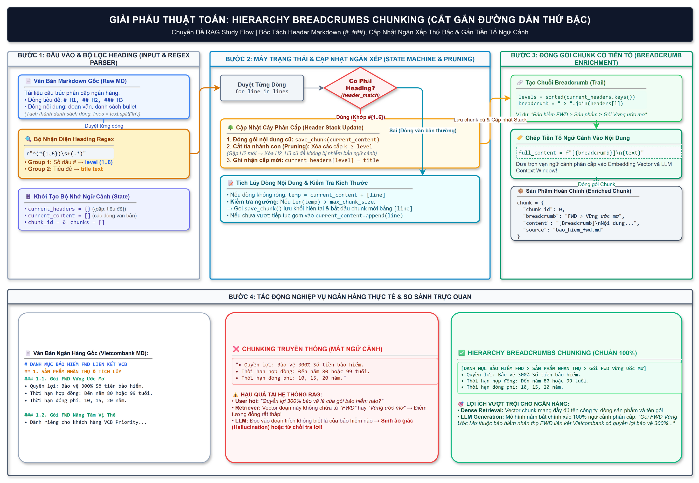

# 📚 CHUYÊN ĐỀ STUDY FLOW: THUẬT TOÁN HIERARCHY BREADCRUMBS CHUNKING

> **Mục tiêu học tập**: Nắm vững cơ chế trích xuất cấu trúc phân cấp Heading Markdown (`#`, `##`, `###`), thuật toán duy trì và cắt tỉa ngăn xếp (Header Stack Pruning), và cách tiền tố Breadcrumb giải quyết triệt để vấn đề mất ngữ cảnh (Context Loss) trong RAG tài chính - ngân hàng.

---

## 1. Sơ Đồ Thuật Toán Trực Quan (Draw.io Flowchart)



*(File thiết kế gốc: [`hierarchy_breadcrumbs_chunking.drawio`](hierarchy_breadcrumbs_chunking.drawio) và bản lưu trữ tại [`docs/flow diagram/hierarchy_breadcrumbs_chunking.drawio`](file:///d:/Desktop/GitHub/AI%20Banking%20Asistant/docs/flow%20diagram/hierarchy_breadcrumbs_chunking.drawio))*

---

## 2. Bản Chất Kỹ Thuật & Cơ Chế Hoạt Động

Trong văn bản nghiệp vụ ngân hàng (biểu phí, sản phẩm thẻ, gói vay, hợp đồng bảo hiểm), thông tin luôn được bố cục theo cấu trúc hình cây (Tree Hierarchy):
* **Cấp 1 (`#`)**: Nhóm sản phẩm hoặc Tên định chế (vd: *Danh Mục Bảo Hiểm FWD Liên Kết Ngân hàng*).
* **Cấp 2 (`##`)**: Phân loại nghiệp vụ (vd: *1. Các Sản Phẩm Bảo Hiểm Nhân Thọ & Sức Khỏe*).
* **Cấp 3 (`###`)**: Nhóm sản phẩm cụ thể (vd: *1.1. Nhóm Bảo Hiểm Bảo Vệ & Tích Lũy*).
* **Nội dung con**: Chi tiết quyền lợi, hạn mức, lãi suất, điều kiện.

### Quy Trình Cập Nhật Ngăn Xếp (Header Stack & Pruning)
Thuật toán sử dụng một cấu trúc từ điển/ngăn xếp `current_headers = {level: title}`:
1. **Quét dòng bằng Regex**: Nhận diện dòng bắt đầu bằng `^(#{1,6})\s+(.*)` để trích xuất `level` (1 đến 6) và tiêu đề `title`.
2. **Cắt tỉa nhánh con (Pruning)**: Khi gặp một tiêu đề mới ở `level = L`:
   $$\text{Xóa toàn bộ các cấp } k \ge L \text{ trong } current\_headers$$
   *Ví dụ:* Đang ở `### 1.1`, nếu gặp `### 1.2` thì cấp 3 cũ bị xóa và thay thế bằng `1.2`. Cấp 1 và Cấp 2 của cha vẫn được giữ nguyên.
3. **Sinh chuỗi Breadcrumbs**:
   $$\text{Breadcrumb} = \text{" > "}.\text{join}([current\_headers[k] \text{ với } k \text{ tăng dần}])$$
4. **Ghép tiền tố (Context Prefixing)**:
   $$\text{Full Content} = \text{f"[\{Breadcrumb\}]\n\{Text Block\}"}$$

---

## 3. Mã Nguồn Triển Khai ([`hierachy_breadcrumb.py`](file:///d:/Desktop/GitHub/AI%20Banking%20Asistant/rag_modular/chunking/hierachy_breadcrumb.py))

```python
import re
from pathlib import Path

def load_document():
    project_root = Path(__file__).resolve().parents[2]
    dataset_dir = project_root / "dataset" / "retrieval" / "retrieval_dataset"
    documents = []
    for file_path in dataset_dir.glob("*.md"):
        with open(file_path, "r", encoding="utf-8") as f:
            documents.append({
                "source": file_path.name,
                "content": f.read()
            })
    return documents

def hierarchy_breadcrumb_chunking(text: str, max_chunk_size: int = 512):
    chunks = []
    lines = text.split("\n")
    
    current_headers = {} # {cấp_độ: tiêu_đề}
    current_content = []
    chunk_id = 0

    def get_breadcrumb_str():
        levels = sorted(current_headers.keys())
        return " > ".join(current_headers[lvl] for lvl in levels)

    def save_chunk(content_lines):
        nonlocal chunk_id
        text_block = "\n".join(content_lines).strip()
        if not text_block:
            return
        
        breadcrumb = get_breadcrumb_str()
        full_content = f"[{breadcrumb}]\n{text_block}" if breadcrumb else text_block
        
        chunks.append({
            "chunk_id": chunk_id,
            "breadcrumb": breadcrumb,
            "content": full_content
        })
        chunk_id += 1

    for line in lines:
        header_match = re.match(r"^(#{1,6})\s+(.*)", line.strip())
        
        if header_match:
            if current_content:
                save_chunk(current_content)
                current_content = []
            
            level = len(header_match.group(1))
            title = header_match.group(2).strip()
            
            # Cắt tỉa các cấp con sâu hơn hoặc bằng cấp hiện tại
            current_headers = {k: v for k, v in current_headers.items() if k < level}
            current_headers[level] = title
        else:
            if line.strip():
                temp_text = "\n".join(current_content + [line])
                if len(temp_text) > max_chunk_size and current_content:
                    save_chunk(current_content)
                    current_content = [line]
                else:
                    current_content.append(line)
                    
    if current_content:
        save_chunk(current_content)
        
    return chunks
```

---

## 4. Tác Động Nghiệp Vụ Thực Tế Trong Ngân Hàng

| Tiêu chí | Chunking Thông Thường | Hierarchy Breadcrumb Chunking |
| :--- | :--- | :--- |
| **Nội dung chunk** | `• Quyền lợi: Bảo vệ 300% STBH.` | `[Bảo hiểm FWD > Gói Vững Ước Mơ]\n• Quyền lợi: Bảo vệ 300% STBH.` |
| **Dense Retrieval** | Điểm tương đồng thấp nếu truy vấn chứa tên sản phẩm/thương hiệu. | Điểm tương đồng cực cao vì chunk mang đầy đủ từ khóa phân cấp. |
| **LLM Generation** | Dễ sinh ảo giác hoặc từ chối trả lời vì thiếu chủ thể sở hữu quyền lợi. | Trả lời chính xác 100% tên gói, ngân hàng phân phối và quyền lợi. |
